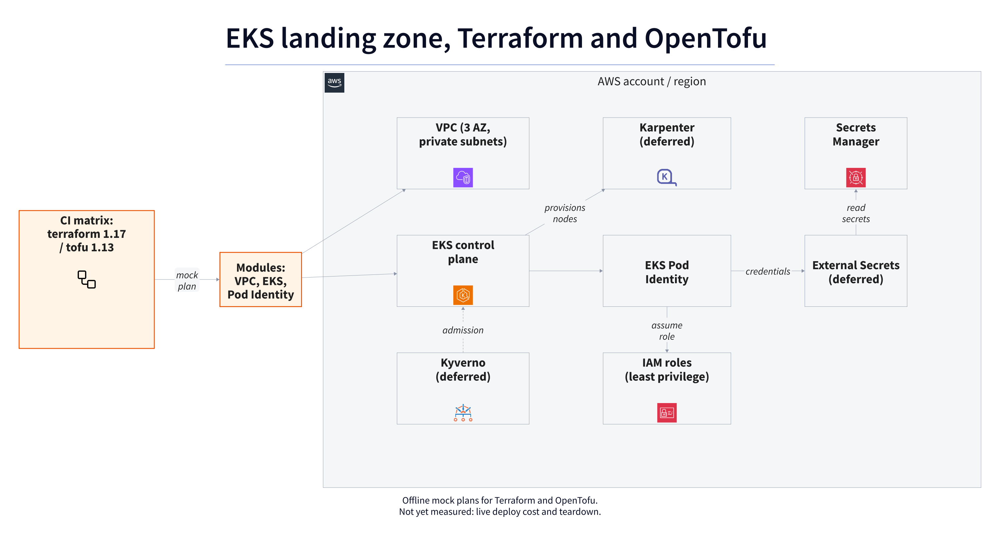

# eks-landing-zone

[](https://github.com/H-Nizami/eks-landing-zone/actions/workflows/ci.yml)

> **Result:** 23/23 mocked plan tests pass with Terraform 1.17 and OpenTofu 1.13 on the same three foundation modules. Not yet measured: live deploy and teardown cost after an approved AWS run.

Terraform and OpenTofu EKS foundation. The first stage implements the VPC, private EKS control plane and optional scoped Pod Identity role; runtime add-ons follow in later stages.



## Architecture

The same modules and mock-provider plan tests run with Terraform 1.17 and OpenTofu 1.13. The VPC spans three availability zones and gives private subnets NAT egress. EKS uses only those private subnets, a private API endpoint, encrypted logs and secrets, and an explicit operator access entry. Optional Pod Identity restricts a workload role to a specific cluster, namespace, service account and secret ARNs. Karpenter, External Secrets and Kyverno are deferred.

Orange boxes are the parts this repo will build; grey boxes are AWS services and existing projects. Diagram source: [`docs/architecture.d2`](docs/architecture.d2).

## Quickstart

```bash
make tools     # install pinned d2, actionlint, gitleaks, trivy into .bin/
make diagram   # render docs/img/architecture.{svg,png}
make lint test
make security
```

`make test-iac CLI=terraform` and `make test-iac CLI=tofu` run the offline suites individually. See [testing notes](docs/testing.md) and [example inputs](examples/foundation/terraform.tfvars.example). `make up` and `make down` intentionally fail pending deployment approval. No credentials are required for the mocked tests.

## Design decisions

- [0001: Record decisions as short ADRs](docs/decisions/0001-record-decisions.md)
- [0002: One module set, tested with both terraform and tofu](docs/decisions/0002-terraform-and-opentofu.md)
- [0003: Validate the foundation offline first](docs/decisions/0003-offline-foundation.md)
- [Pinned action SHAs and tool versions](docs/pins.md)

## Limits

- The EKS control plane is billed hourly, so real deploys are short and rare; most testing is `validate`, `plan` and static analysis.
- The module set targets a single AWS account and region.
- No worker nodes or Pod Identity agent are provisioned yet, so the association cannot deliver runtime credentials. The private API also needs a network path for operators.

## How I'd do this for your team

- Discovery: review your current AWS accounts, network layout, IAM model and which CLI (terraform or OpenTofu) you run.
- Adapt: fit the modules to your CIDR plan, node pool shapes, secret stores and admission policies.
- Prove: run the plan matrix in your CI and a short, torn-down deploy in a sandbox account.
- Hand-over: runbooks for upgrades (EKS, Karpenter, add-ons), adding a workload role, and rotating secrets.

## Status

| Stage | Scope | Status |
|---|---|---|
| Scaffold | Repo standards, CI, cover diagram | Done |
| Offline foundation | VPC/EKS/Pod Identity modules and offline dual-CLI tests | Done locally; CI run pending |
| Compute and add-ons | Compute, runtime add-ons and a short real deploy | Planned (needs AWS credits) |

## License

Apache-2.0. See LICENSE.
